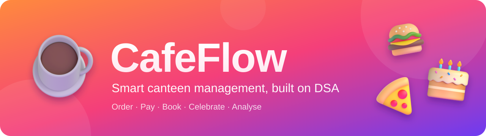
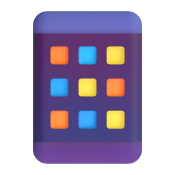
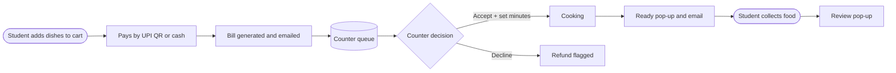

<div align="center">



<br>


### Order smarter. Cook faster. Wait less.

[Features](#-features) &nbsp;•&nbsp; [How it works](#-how-an-order-flows) &nbsp;•&nbsp; [DSA map](#-data-structures--algorithms) &nbsp;•&nbsp; [Quick start](#-quick-start) &nbsp;•&nbsp; [Security](#-security--privacy) &nbsp;•&nbsp; [License](#-license)

</div>

---

##  What is CafeFlow?

Campus canteens are busy: long queues, shouting orders, lost tokens, no idea when food will be ready. **CafeFlow** is a full-stack web app that fixes this. Students order and pay from their phone, counters see a live queue and tell students how long the food will take, and the admin watches the whole canteen from one dashboard.

It is also a **data structures and algorithms project**. Every core feature runs on structures and algorithms written from scratch (no built-in sort, search or queue libraries for the main logic), so each screen in the app is a working example of something from the syllabus.

<table>
<tr>
<td align="center" width="33%"><br><b>Students</b><br>Order, pay, book tables, plan parties, track food live</td>
<td align="center" width="33%"><br><b>Counters</b><br>Accept orders, set cooking time, manage menu, see sales charts</td>
<td align="center" width="33%"><br><b>Admin</b><br>Customers, payments, reviews, analytics and controls</td>
</tr>
</table>

---

##  Features

###  For students

<table>
<tr>
<td width="50%" valign="top">

** Order and pay**<br>
Browse two floors (one pure veg), search dishes, add to cart with undo, then pay by UPI QR (Google Pay, PhonePe, Paytm and more) or cash. Get a till-roll bill as HTML and PDF, also sent by email.

</td>
<td width="50%" valign="top">

** Live order tracking**<br>
Pop-up alerts when your order is accepted, being cooked and ready. See "N orders ahead of you" in the queue.

</td>
</tr>
<tr>
<td valign="top">

** Seat booking**<br>
Reserve a table or sofa on a floor map for a specific time slot. Counters and admin are notified.

</td>
<td valign="top">

** Pre-order plans**<br>
Pick a counter, dishes, and a plan from 1 day to 1 year. Longer plans get bigger discounts (8% to 25%) and each day's meal is released into the queue 60 minutes before pickup.

</td>
</tr>
<tr>
<td valign="top">

** Plan a birthday party**<br>
Pre-book tables, cakes, pastries, fries and drinks for 4 to 30 guests. Tiered discounts up to 25%, free candles and a cake message, and tables found automatically by the seat planner.

</td>
<td valign="top">

** Reviews and Stories**<br>
Rate every order with a star pop-up, read an animated review wall, and tap through Instagram-style stories of bestsellers and offers.

</td>
</tr>
<tr>
<td colspan="2" valign="top">

** CafeFlow Assistant**<br>
A free chatbot (bottom-right bubble) that answers questions about dishes, prices, offers, order status, tables, pre-orders and parties, and can add dishes to your cart. It reuses the project's own algorithms: BST for dish lookup, merge sort for "cheapest" lists, knapsack DP for "plan my meal for Rs 150" and greedy for "change for 500, bill 137".

</td>
</tr>
</table>

###  For counters (vendors)

- **Live order queue**: accept or decline, set a preparation time, mark ready (the student gets a pop-up and an email)
- **Menu and stock control**: add, remove and update dishes
- **Sales dashboard**: charts and payment history in the style of food-delivery apps
- **Reviews, pre-orders and party prep lists** for the items they need to cook

###  For the admin

- Overview of every counter, customer and payment
- Behaviour analytics and **basket analysis (Apriori)** showing what is bought together
- Reviews, offers and ads, authority controls, birthday party report
- An **Algorithm lab** to watch the data structures work

---

##  How an order flows



---

##  Data structures & algorithms

Every phase of the course is used for a real feature, not just a demo.

| Phase | Topic | Where you see it in CafeFlow |
|:---:|---|---|
| 🟦 **1** | **Linked list, stack, queue** | Users, menu, carts, orders and bookings are stored in linked lists. Each counter has a queue and only the front order can be accepted. A stack holds the admin activity log, the cart *Undo*, and bill-expression checking. |
| 🟩 **2** | **Binary tree, BST, graph** | Dish search on a BST with in-order, pre-order and post-order animation. The canteen map is a graph (adjacency list and matrix) with BFS and DFS routes. |
| 🟧 **3** | **Searching and sorting** | Linear and binary search, plus an insertion sort vs merge sort race that shows comparison counts. Sorting is also used inside menus, reports and rankings. |
| 🟪 **4** | **Greedy, DP, backtracking** | Greedy change-maker for cash orders, 0/1 knapsack budget meal planner, backtracking seat allocator for groups and birthday parties. |
| 🟥 **Extra** | **Apriori mining** | "Bought together" association rules for the admin. |

**Learn by watching:** the app has interactive labs you can open while it runs.

| Page | What it shows |
|---|---|
| `/linear` | Step-by-step animated linked list, stack and queue with the running line of code highlighted |
| `/tree` | The BST drawn live with traversals |
| `/map` | The canteen graph and BFS/DFS routes |
| `/algo` | Sorting race and search comparison counts |
| `/solve` | Greedy, DP and backtracking solvers |
| `/phases` | A live checklist of all four phases |

---

##  Tech stack


---

##  Quick start

```bash
# 1. Get the code (access is by permission, see License)
git clone https://github.com/26mcac01-ABenedictPaul/CafeFlow.git
cd CafeFlow

# 2. Install dependencies
pip install -r requirements.txt

# 3. Set your secrets (never commit these)
export SECRET_KEY="choose-a-long-random-string"
export ADMIN_PASS="choose-a-strong-password"

# 4. Run
python app.py          # then open http://127.0.0.1:5000

# 5. Test every phase
python tests.py
```

Students register on the login page. Counter and admin accounts are set in your own local configuration, which is not part of this repository.

### Settings

| Setting | Default | What it does |
|---|---|---|
| `PURE_VEG_FLOORS` | `{1: True, 2: False}` | Floor 1 is veg-only, Floor 2 is mixed. Restart to rebuild the menu (users and orders are kept). |
| `GST_PERCENT` | `5` | GST line on the bill. It is already inside menu prices, so totals do not change. `0` hides it. |
| `BUSINESS` | name, address, phone | Printed at the top of every bill. |
| `UPI_MERCHANT` | your UPI ID | Makes the payment QR real. |
| `PARTY_TIERS`, `PARTY_EARLY`, `PARTY_MAX_PCT` | see `app.py` | Birthday party discounts. |

**Email:** set `GMAIL_USER` and `GMAIL_APP_PASSWORD` to send real emails. Otherwise they print in the terminal.

**Payment logos:** put `gpay`, `phonepe`, `paytm`, `upi` and `cod` images in `static/img/pay/`.

###  Deploy on Render

| | |
|---|---|
| Build command | `pip install -r requirements.txt` |
| Start command | `gunicorn app:app --workers 1 --threads 4 --timeout 120` |
| Environment | `SECRET_KEY`, `ADMIN_PASS`, `GMAIL_USER`, `GMAIL_APP_PASSWORD` |

Keep **one worker**: data lives in memory and is saved to `data.json`. On Render's free plan the file system resets on every redeploy.

---

##  Security & privacy

| | |
|---|---|
| 🔑 **No secrets in the code** | Keys, admin and counter passwords come from environment variables, never from the repository. |
| 🔒 **Encrypted in transit** | Deploy behind HTTPS (Render provides it) so logins and orders cannot be read on the network. |
| 🧂 **Hashed passwords** | Passwords are stored as one-way hashes, never as plain text. |
| 🧱 **Role separation** | Student, counter and admin pages are separate. A counter sees only its own orders. |
| 🙈 **Private data stays private** | `data.json` (real accounts and orders) is excluded with `.gitignore`. |

> This is a course project with simulated payments. Before real use, move storage to a database and have the security reviewed.

---

##  Project structure

```text
CafeFlow/
├── app.py          Flask routes and app logic
├── ds.py           Linked list, stack, queue, BST, graph, searches, sorts
├── algos.py        Greedy, dynamic programming, backtracking
├── mining.py       Apriori basket analysis
├── chatbot.py      Rule-based assistant (BST, merge sort, DP, greedy)
├── get_images.py   Downloads food photos (see credits)
├── tests.py        Automated tests for every phase and main pages
├── templates/      Jinja pages (student, counter, admin)
├── static/         CSS, JS and images
├── legacy/         Phase 1 console program
├── assets/         README banner, logo and icons
└── LICENSE
```

---

##  Roadmap

- [ ] Real UPI payment gateway
- [ ] Database (PostgreSQL) instead of `data.json`
- [ ] Login with hashed passwords and sessions for every role
- [ ] Star-rating alerts to counters when a dish's rating drops
- [ ] Extra floors and canteen branches with a background worker for pre-orders

---

##  License

**Copyright © 2026 A Benedict Paul. All rights reserved.**

This is proprietary software. You may not copy, modify, distribute or use it without written permission. Seeing the code on GitHub does not grant any of these rights. See [`LICENSE`](LICENSE).

## 🙏 Credits

- 3D icons: [Fluent Emoji](https://github.com/microsoft/fluentui-emoji) by Microsoft (MIT), see [`assets/icons/CREDITS.md`](assets/icons/CREDITS.md)
- Food photographs: sourced via [Openverse](https://openverse.org). Each image stays under its original license and creator credit.

<div align="center">


**Made with ☕ and a lot of linked lists by [A Benedict Paul](https://github.com/26mcac01-ABenedictPaul)**

</div>
